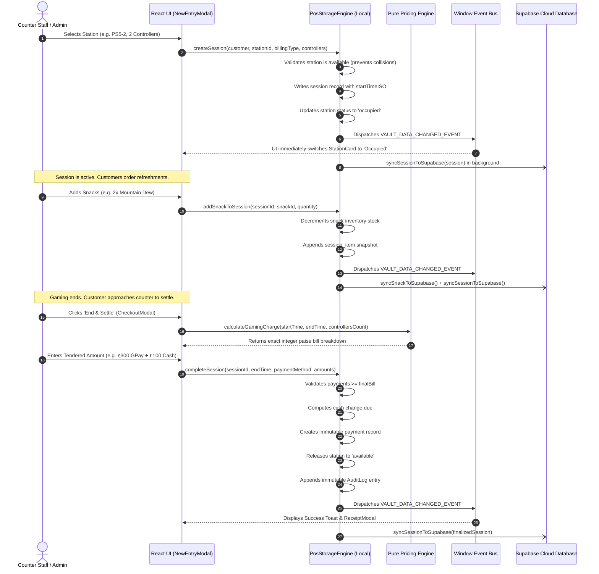

# System Architecture: VAULT 147 POS

## 1. Architectural Philosophy: The Dual-Engine Paradigm

VAULT 147 POS is engineered around an **Offline-First Dual-Engine Architecture**. Gaming lounges require instantaneous responsiveness at the counter; delays or loading spinners during peak check-in/checkout hours create severe operational friction. Furthermore, network instability must never prevent staff from starting timers, serving refreshments, or collecting payments.

To achieve both instantaneous local performance and global multi-device cloud synchronization, the system bifurcates responsibilities between two cooperating engines:

1. **The In-Browser Storage Engine (`PosStorageEngine`)**:
   - Resides directly in the client browser runtime ([`src/services/storage.ts`](file:///c:/Users/arsha/Downloads/Vault%20Digital/src/services/storage.ts)).
   - Serves as the immediate synchronous read/write Data Access Layer.
   - Provides sub-millisecond execution times for state updates, session starts, checkouts, and stock changes.
   - Dispatches a centralized window event (`VAULT_DATA_CHANGED_EVENT`) to immediately re-render active React components.

2. **The Cloud Synchronization Engine (`SupabaseClient`)**:
   - Connects to a managed PostgreSQL instance via `@supabase/supabase-js` ([`src/services/supabase.ts`](file:///c:/Users/arsha/Downloads/Vault%20Digital/src/services/supabase.ts)).
   - Operates entirely asynchronously in the background.
   - Replicates transactions, payments, stock levels, and expenses to the cloud.
   - Listens to PostgreSQL change feeds via WebSockets (`subscribeToSupabaseSessions`) so changes on mobile devices or other counter terminals reflect everywhere in real time.

---

## 2. End-to-End System Architecture

```mermaid
flowchart TB
    subgraph Browser_Environment["Client Browser Runtime"]
        subgraph UI_Layer["React 19 Presentation Layer"]
            App["AppContent & Modals"]
            Views["Dashboard / Sessions / Concessions / Expenses"]
            Auth["AuthContext (RBAC & Inactivity Timer)"]
        end

        subgraph Event_Bus["Internal Event Dispatcher"]
            Bus["VAULT_DATA_CHANGED_EVENT"]
        end

        subgraph Core_Engine["Local Storage Engine (storage.ts)"]
            Engine["PosStorageEngine Singleton"]
            Calculators["Pure Pricing & Duration Engine (pricing.ts)"]
            Formatters["Formatters & Masking (formatters.ts)"]
            SafeStorage["SafeStorage (Encrypted LocalStorage Proxy)"]
        end

        subgraph Cloud_Service["Cloud Sync Layer (supabase.ts)"]
            SyncManager["Background Sync Worker"]
            RealtimeSub["Realtime WebSocket Subscriber"]
        end
    end

    subgraph Supabase_Cloud["Supabase Managed Cloud (PostgreSQL 15+)"]
        Postgres_DB[("PostgreSQL Database
        - sessions & session_items
        - payments & products
        - daily_expenses & daily_closings
        - audit_logs & profiles")]
        GoTrue["Supabase Auth (GoTrue)"]
        Realtime_Server["Realtime WebSocket Engine"]
    end

    %% Interactions
    Views -->|Action (Start / Checkout / Snack)| Engine
    Engine --> Calculators
    Engine --> SafeStorage
    Engine -->|Triggers UI Refresh| Bus
    Bus -->|Re-renders View| Views
    
    Engine -.->|Asynchronous Non-Blocking Write| SyncManager
    SyncManager -->|PostgREST Upsert / Delete| Postgres_DB
    
    Realtime_Server -->|Push Notification| RealtimeSub
    RealtimeSub -->|Pull Latest Remote Rows| Engine
    
    Auth <-->|Session Tokens| GoTrue
```

---

## 3. Data Flow & Lifecycle of a Station Session

Every gaming session follows a deterministic, audited lifecycle:



---

## 4. Re-conciliation & Multi-Device Synchronization

Because the venue may use multiple counter devices (e.g. Counter PC, Administrator Tablet, and Mobile Smartphone), cloud synchronization maintains two-way parity:

### Outgoing Cloud Synchronization (Write Path)
Whenever any mutative method executes (`createSession`, `completeSession`, `createSnack`, `updateSnack`, `addExpense`, `updatePricingConfig`), the engine:
1. Commits the transaction to browser storage immediately.
2. Emits `VAULT_DATA_CHANGED_EVENT` to update the local screen.
3. Invokes the matching Supabase export asynchronously inside a `try/catch` block:
   ```ts
   emitDataChanged();
   try {
     syncSnackToSupabase(updated).catch(() => {});
   } catch {}
   ```
4. Even if the network drops or rejects the request, the user's operation is not aborted.

### Incoming Cloud Synchronization (Read Path)
To receive modifications made from other devices:
1. **Real-time WebSockets (Primary)**: `subscribeToSupabaseSessions()` establishes a live channel (`sessions-all-changes`) on PostgreSQL table mutations, automatically triggering a refresh upon changes with zero idle egress bandwidth.
2. **App Focus / Tab Visibility Resumption**: When a smartphone unlocks or the user switches back to the POS browser tab, a `visibilitychange` listener immediately queries Supabase to prevent stale states.
3. **Low-Frequency Fallback Heartbeat**: Every 5 minutes (`300000ms`), `AppContent` triggers a background heartbeat query (only when the tab is visible) to guard against dropped socket connections while conserving Supabase free-tier quota.
4. **Catalogue & Rate Synchronization**: In [`src/services/storage.ts`](file:///c:/Users/arsha/Downloads/Vault%20Digital/src/services/storage.ts), `fetchAndMergeCloudData()` downloads remote snacks and business rates, merging them seamlessly into local state while purging legacy items.

---

## 5. Background Jobs & Scheduled Timers

The system maintains several standing timers to handle automation and security:

| Timer Name | Interval / Schedule | Location | Purpose |
| :--- | :--- | :--- | :--- |
| **Realtime Session Channel** | Event-driven (WebSocket) | [`src/App.tsx`](file:///c:/Users/arsha/Downloads/Vault%20Digital/src/App.tsx) | Pushes instant remote session updates from Supabase to maintain multi-device parity with minimal network egress. |
| **Fallback Heartbeat** | 5 minutes (visible tab only) | [`src/App.tsx`](file:///c:/Users/arsha/Downloads/Vault%20Digital/src/App.tsx) | Periodic safety sync ensuring state consistency in the event of dropped WebSocket frames. |
| **Exit Backup (`beforeunload`)** | On tab/browser close | [`src/pages/TransactionsPage.tsx`](file:///c:/Users/arsha/Downloads/Vault%20Digital/src/pages/TransactionsPage.tsx) | Executes an emergency final sync to Supabase before the window unloads. |
| **Inactivity Monitor** | 30 seconds | [`src/context/AuthContext.tsx`](file:///c:/Users/arsha/Downloads/Vault%20Digital/src/context/AuthContext.tsx) | Verifies session expiry and logs out inactive staff after 4 hours of inactivity. |
| **Settlement Toast Auto-Dismiss** | 7 seconds | [`src/App.tsx`](file:///c:/Users/arsha/Downloads/Vault%20Digital/src/App.tsx) | Auto-dismisses the post-checkout confirmation notification banner. |

---

## 6. Error-Handling Architecture

The architecture enforces strict fail-safe isolation across all tiers:

1. **Storage Fallback Strategy**:
   - Browser `localStorage` is wrapped in a `safeStorage` proxy.
   - If `localStorage` is blocked (e.g. browser private browsing restrictions or quota limits), the engine transparently falls back to an in-memory dictionary without throwing unhandled exceptions.

2. **Network Partition Tolerance**:
   - Supabase network calls are treated as optional non-blocking enhancements.
   - A network failure logs a clean warning and queues records for the next synchronization cycle without interrupting the user.

3. **Transaction Rollback & Collision Guards**:
   - Station check-ins guard against race conditions: if a station is already occupied, `createSession()` rejects the request before writing to storage.
   - Checkouts verify the session is active and not already finalized, preventing double-billing or multiple payments for the same session.

