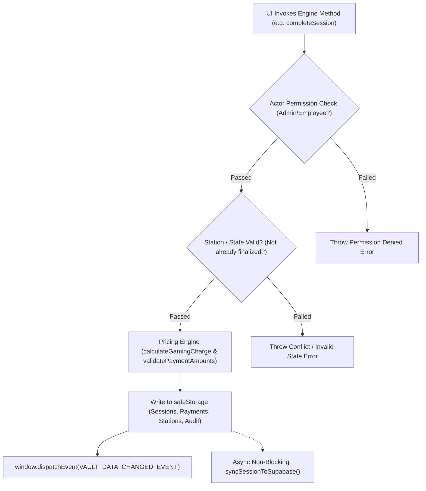

# Backend & Storage Engine Documentation: VAULT 147 POS

## 1. Architectural Paradigm: In-Browser Backend Engine

VAULT 147 POS utilizes an **Embedded Storage Engine Architecture**. Because the application is deployed as a high-speed Single Page Application capable of autonomous offline execution, the traditional backend responsibilities (Data Access Layer, Business Rules Enforcement, Session Management, Auditing, and Transaction Validation) are encapsulated inside the **`PosStorageEngine`** ([`src/services/storage.ts`](file:///c:/Users/arsha/Downloads/Vault%20Digital/src/services/storage.ts)).

Simultaneously, **Supabase Cloud** acts as the remote persistent cloud backend, providing managed PostgreSQL 15+, GoTrue identity authentication, Row-Level Security (RLS), and WebSockets.

---

## 2. Engine Layer Breakdown

```text
┌───────────────────────────────────────────────────────────────┐
│                    React Presentation Tier                    │
└───────────────────────────────▲───────────────────────────────┘
                                │ Method calls / Event bus
┌───────────────────────────────▼───────────────────────────────┐
│                     PosStorageEngine (storage.ts)             │
│  - Session Orchestration      - Concessions Stock Tracker     │
│  - Payment Split Validation   - Cash Drawer Balancing         │
│  - Audit Trail Generation     - Cryptographic Auth Sessions   │
└───────────────┬───────────────────────────────┬───────────────┘
                │ Pure Calculations             │ Asynchronous Sync
┌───────────────▼───────────────┐ ┌─────────────▼───────────────┐
│     Pricing & Duration Math   │ │  Supabase Service Client    │
│         (pricing.ts)          │ │       (supabase.ts)         │
└───────────────────────────────┘ └─────────────┬───────────────┘
                                                │ REST / WebSockets
                                  ┌─────────────▼───────────────┐
                                  │  Supabase Cloud PostgreSQL  │
                                  └─────────────────────────────┘
```

---

## 3. Storage Engine Initialization (`init()`)

When `db` (the singleton instance of `PosStorageEngine`) is initialized:
1. **User Identity Verification**: Ensures at least the default Administrator (`Ruwaidh (Admin)`) exists. Automatically migrates legacy names.
2. **Station Roster Verification**: Ensures 6 gaming stations (`ps5-1` to `ps5-3`, `pool-1` to `pool-3`) and the walk-in concessions counter (`station-walk-in`) exist.
3. **Catalogue Migration & Deprecation Purge**: Inspects stored snack items. If legacy items (Red Bull, Lay's, Maggi) are detected, replaces them with the 10 active client catalogue items and marks `vault_snacks_v3_client_migrated`.
4. **Pricing Configuration**: Instantiates standard pricing rules (₹150/hr PS5 solo, ₹300/hr PS5 dual, ₹250/hr snooker, 5-minute grace period).
5. **Background Cloud Reconciliation**: In non-test environments with Supabase configured, calls `fetchAndMergeCloudData()` to reconcile cloud changes.

---

## 4. Business Logic Services

### A. Session Management & Collisions (`storage.ts`)
- **`createSession(params)`**:
  - Checks station status. If status is `'occupied'`, immediately throws `Error: Station is already occupied by an active session.`
  - Writes new session with `startTime` in ISO 8601 UTC.
  - Updates station status to `'occupied'` and sets `activeSessionId`.
  - Decrements initial snacks from stock.
  - Logs `SESSION_STARTED` in the immutable audit trail.
  - Dispatches `VAULT_DATA_CHANGED_EVENT`.
  - Pushes session asynchronously to Supabase.

- **`completeSession(params)`**:
  - Validates session is in `'active'` status.
  - Calculates duration and billing charges via `calculateGamingCharge`.
  - Validates payment amounts against final bill via `validatePaymentAmounts`.
  - If cash tendered exceeds bill, calculates `changeDuePaise`.
  - Sets station status back to `'available'` and clears `activeSessionId`.
  - Generates immutable `PaymentRecord`.
  - Logs `SESSION_COMPLETED` with previous and new states.
  - Dispatches `VAULT_DATA_CHANGED_EVENT`.
  - Pushes finalized session and payment to Supabase.

- **`voidSession(sessionId, reason, actor)`**:
  - Requires `'admin'` role; rejects employees.
  - Marks session `isVoided = true` and updates status to `'cancelled'`.
  - **Restores consumed inventory**: Iterates over session items and restores product stock levels.
  - Sets station back to `'available'` if session was active.
  - Logs `SESSION_VOIDED` with the mandatory justification reason.

### B. Payment Details Modification (`updatePaymentDetails`)
- Allows administrators to correct accidental cashier selections (e.g., cashier clicked GPay when customer paid cash, or vice-versa).
- Enforces `totalReceived >= finalBill`.
- Updates `cashAmountPaise`, `gpayAmountPaise`, `changeDuePaise`, and notes.
- Logs `PAYMENT_UPDATED` with full before-and-after audit diff.

### C. Concessions & Stock Inventory (`createSnack`, `updateSnack`, `deleteSnack`)
- Every snack maintains `stock` and `lowStockThreshold`.
- `updateSnack` updates values and actively pushes upserts to Supabase `public.products`.
- Out-of-stock items (`stock: 0`) remain permanently at 0 without reset.

### D. Operational Expenses (`addExpense`, `updateExpense`, `deleteExpense`)
- Admins record venue costs across 8 predefined categories.
- Tracks whether expenses were paid from cash drawer, GPay, or bank transfer.
- Updates daily cash drawer reconciliation and net profit metrics.

---

## 5. Middleware, Interceptors & Security Checks

### A. Storage Protection Proxy (`safeStorage`)
To prevent fatal crashes in environments where browser `localStorage` is disabled or restricted (e.g. headless Vitest, private browser tabs):
```ts
class SafeStorageWrapper {
  private fallbackMemory = new Map<string, string>();
  // Transparently delegates to window.localStorage with automatic in-memory fallback
}
```

### B. Role-Based Permission Guard
Methods modifying system rates, catalogues, staff accounts, or voiding transactions enforce actor authorization:
```ts
if (actor.role !== 'admin') {
  throw new Error('Permission denied: Administrator credentials required.');
}
```

### C. Progressive Rate-Limiter Interceptor
On user authentication:
1. Normalizes email.
2. Checks `lockedUntil` timestamp.
3. If locked, throws `Too many failed login attempts. Account temporarily locked for X seconds.`
4. Increments failed attempt count; after 5 attempts, sets a 60-second lockout.

---

## 6. Lifecycle of an Operation (Sequence)



