# Database Schema & Data Models: VAULT 147 POS

## 1. Database Architecture & Engine

- **Database Engine**: PostgreSQL 15+ managed by **Supabase**.
- **Extensions**: `uuid-ossp` for cryptographically strong unique identifiers.
- **Monetary Storage Standard**: **Integer Paise (`INTEGER`)** across all tables (`CHECK (column >= 0)`). Floating-point numeric types are strictly forbidden for currency to prevent IEEE 754 precision drift.
- **Timestamp Standard**: UTC Timestamps with Timezone (`TIMESTAMPTZ NOT NULL DEFAULT timezone('utc'::text, now())`).

---

## 2. Entity-Relationship (ER) Diagram

```mermaid
erDiagram
    PROFILES ||--o{ SESSIONS : "creates / completes"
    PROFILES ||--o{ PAYMENTS : "records"
    PROFILES ||--o{ DAILY_EXPENSES : "records"
    PROFILES ||--o{ DAILY_CLOSINGS : "closes"
    
    STATIONS ||--o{ SESSIONS : "hosts"
    
    SESSIONS ||--o{ SESSION_ITEMS : "contains"
    SESSIONS ||--|| PAYMENTS : "settled_by"
    
    PRODUCTS ||--o{ SESSION_ITEMS : "catalog_source"
    
    STATIONS {
        text id PK
        text name
        gaming_type gaming_type
        station_status status
        text active_session_id
        integer display_order
    }

    SESSIONS {
        text id PK
        text customer_name
        text customer_phone
        gaming_type gaming_type
        text station_id FK
        billing_type billing_type
        boolean is_multiplayer
        timestamptz start_time
        timestamptz end_time
        integer duration_minutes
        session_status status
        jsonb rate_snapshot
        integer gaming_charge_paise
        integer snack_subtotal_paise
        integer discount_paise
        integer final_bill_paise
        boolean is_voided
    }

    SESSION_ITEMS {
        text id PK
        text session_id FK
        text product_id FK
        text name
        integer quantity
        integer unit_price_paise
        integer line_total_paise
        boolean is_custom
    }

    PAYMENTS {
        text id PK
        text session_id FK
        payment_method method
        integer gpay_amount_paise
        integer cash_amount_paise
        integer total_received_paise
        integer final_bill_paise
        integer outstanding_balance_paise
        payment_status status
        timestamptz timestamp
    }

    PRODUCTS {
        text id PK
        text name
        text category
        integer price_paise
        boolean is_active
        integer stock
        integer low_stock_threshold
    }

    DAILY_EXPENSES {
        text id PK
        date date
        text title
        text category
        integer amount_paise
        text payment_method
        text receipt_number
    }

    DAILY_CLOSINGS {
        text id PK
        date closing_date
        integer expected_cash_paise
        integer counted_cash_paise
        integer cash_variance_paise
        integer gpay_total_paise
        integer total_sales_paise
        jsonb denominations
    }

    AUDIT_LOGS {
        text id PK
        text actor_id
        text actor_name
        user_role actor_role
        text action
        text entity_type
        text entity_id
        text details
        jsonb previous_state
        jsonb new_state
        timestamptz timestamp
    }
```



---

## 3. Custom PostgreSQL Enums

```sql
CREATE TYPE user_role AS ENUM ('admin', 'employee');
CREATE TYPE gaming_type AS ENUM ('ps5', 'pool');
CREATE TYPE station_status AS ENUM ('available', 'occupied', 'maintenance');
CREATE TYPE billing_type AS ENUM ('hourly', 'fixed');
CREATE TYPE session_status AS ENUM ('active', 'completed', 'cancelled');
CREATE TYPE payment_method AS ENUM ('gpay', 'cash', 'split');
CREATE TYPE payment_status AS ENUM ('PAID', 'PARTIAL', 'UNPAID', 'VOIDED');
```

---

## 4. Tables and Columns Specification

### 1. `public.profiles` (User Accounts)
Stores staff and administrator accounts linked to Supabase Auth (`auth.users`).
```sql
CREATE TABLE public.profiles (
  id UUID PRIMARY KEY REFERENCES auth.users(id) ON DELETE CASCADE,
  email TEXT NOT NULL UNIQUE,
  display_name TEXT NOT NULL,
  role user_role NOT NULL DEFAULT 'employee',
  is_active BOOLEAN NOT NULL DEFAULT true,
  created_at TIMESTAMPTZ NOT NULL DEFAULT timezone('utc'::text, now()),
  updated_at TIMESTAMPTZ NOT NULL DEFAULT timezone('utc'::text, now())
);
```

### 2. `public.stations` (Hardware & Table Roster)
```sql
CREATE TABLE public.stations (
  id TEXT PRIMARY KEY,                          -- e.g. 'ps5-1', 'pool-1', 'station-walk-in'
  name TEXT NOT NULL,                        -- e.g. 'PS5 Station 1 (VIP Lounge)'
  gaming_type gaming_type NOT NULL,           -- 'ps5' | 'pool'
  status station_status NOT NULL DEFAULT 'available',
  active_session_id TEXT,                     -- Links to active session if occupied
  display_order INTEGER NOT NULL DEFAULT 0,
  created_at TIMESTAMPTZ NOT NULL DEFAULT timezone('utc'::text, now())
);
```

### 3. `public.pricing_config` (Global Business Pricing)
Stores active venue pricing rates and policies. A single row (`cfg-default`) is maintained.
```sql
CREATE TABLE public.pricing_config (
  id TEXT PRIMARY KEY DEFAULT 'cfg-default',
  business_name TEXT NOT NULL DEFAULT 'Vault Gaming Centre',
  business_timezone TEXT NOT NULL DEFAULT 'Asia/Kolkata',
  currency_symbol TEXT NOT NULL DEFAULT '₹',
  ps5_hourly_rate_paise INTEGER NOT NULL DEFAULT 15000,
  ps5_multiplayer_hourly_rate_paise INTEGER NOT NULL DEFAULT 30000,
  ps5_fixed_plans JSONB NOT NULL DEFAULT '[]'::jsonb,
  pool_hourly_rate_paise INTEGER NOT NULL DEFAULT 25000,
  pool_per_frame_rate_paise INTEGER NOT NULL DEFAULT 5000,
  rounding_rule TEXT NOT NULL DEFAULT 'nearest_5',
  allow_custom_snacks BOOLEAN NOT NULL DEFAULT true,
  allow_partial_payments BOOLEAN NOT NULL DEFAULT true,
  max_employee_discount_paise INTEGER NOT NULL DEFAULT 5000,
  updated_at TIMESTAMPTZ NOT NULL DEFAULT timezone('utc'::text, now())
);
```

### 4. `public.products` (Snacks, Drinks, Concessions Catalogue)
```sql
CREATE TABLE public.products (
  id TEXT PRIMARY KEY DEFAULT ('snk-' || extract(epoch from now())::text),
  name TEXT NOT NULL,
  category TEXT NOT NULL DEFAULT 'General',     -- 'Beverages', 'Milkshakes', 'Accessories'
  price_paise INTEGER NOT NULL CHECK (price_paise >= 0),
  is_active BOOLEAN NOT NULL DEFAULT true,
  stock INTEGER NOT NULL DEFAULT 100,
  low_stock_threshold INTEGER NOT NULL DEFAULT 5,
  created_at TIMESTAMPTZ NOT NULL DEFAULT timezone('utc'::text, now()),
  updated_at TIMESTAMPTZ NOT NULL DEFAULT timezone('utc'::text, now())
);
```

### 5. `public.sessions` (Gaming Sessions & Walk-in Records)
```sql
CREATE TABLE public.sessions (
  id TEXT PRIMARY KEY DEFAULT ('sess-' || extract(epoch from now())::text),
  customer_name TEXT NOT NULL,
  customer_phone TEXT,
  gaming_type gaming_type NOT NULL,
  station_id TEXT NOT NULL REFERENCES public.stations(id),
  station_name TEXT NOT NULL,
  billing_type billing_type NOT NULL,
  is_multiplayer BOOLEAN NOT NULL DEFAULT false,
  fixed_plan_id TEXT,
  fixed_plan_name TEXT,
  frames_count INTEGER DEFAULT 1,
  start_time TIMESTAMPTZ NOT NULL,
  end_time TIMESTAMPTZ,
  duration_minutes INTEGER,
  status session_status NOT NULL DEFAULT 'active',
  rate_snapshot JSONB NOT NULL DEFAULT '{}'::jsonb,
  gaming_charge_paise INTEGER NOT NULL DEFAULT 0 CHECK (gaming_charge_paise >= 0),
  snack_subtotal_paise INTEGER NOT NULL DEFAULT 0 CHECK (snack_subtotal_paise >= 0),
  discount_paise INTEGER NOT NULL DEFAULT 0 CHECK (discount_paise >= 0),
  discount_reason TEXT,
  final_bill_paise INTEGER NOT NULL DEFAULT 0 CHECK (final_bill_paise >= 0),
  created_by UUID REFERENCES public.profiles(id),
  created_by_name TEXT NOT NULL,
  completed_by UUID REFERENCES public.profiles(id),
  completed_by_name TEXT,
  notes TEXT,
  is_voided BOOLEAN NOT NULL DEFAULT false,
  void_reason TEXT,
  voided_by UUID REFERENCES public.profiles(id),
  voided_at TIMESTAMPTZ,
  created_at TIMESTAMPTZ NOT NULL DEFAULT timezone('utc'::text, now()),
  updated_at TIMESTAMPTZ NOT NULL DEFAULT timezone('utc'::text, now())
);
```

### 6. `public.session_items` (Concession Purchases on Tab)
```sql
CREATE TABLE public.session_items (
  id TEXT PRIMARY KEY DEFAULT ('item-' || extract(epoch from now())::text || '-' || floor(random() * 1000)::text),
  session_id TEXT NOT NULL REFERENCES public.sessions(id) ON DELETE CASCADE,
  product_id TEXT REFERENCES public.products(id),
  name TEXT NOT NULL,
  quantity INTEGER NOT NULL CHECK (quantity > 0),
  unit_price_paise INTEGER NOT NULL CHECK (unit_price_paise >= 0),
  line_total_paise INTEGER NOT NULL CHECK (line_total_paise >= 0),
  is_custom BOOLEAN NOT NULL DEFAULT false,
  created_at TIMESTAMPTZ NOT NULL DEFAULT timezone('utc'::text, now())
);
```

### 7. `public.payments` (Settlement & Split Tender Records)
```sql
CREATE TABLE public.payments (
  id TEXT PRIMARY KEY DEFAULT ('pay-' || extract(epoch from now())::text),
  session_id TEXT NOT NULL REFERENCES public.sessions(id) ON DELETE RESTRICT,
  method payment_method NOT NULL,
  gpay_amount_paise INTEGER NOT NULL DEFAULT 0 CHECK (gpay_amount_paise >= 0),
  cash_amount_paise INTEGER NOT NULL DEFAULT 0 CHECK (cash_amount_paise >= 0),
  total_received_paise INTEGER NOT NULL DEFAULT 0 CHECK (total_received_paise >= 0),
  final_bill_paise INTEGER NOT NULL DEFAULT 0 CHECK (final_bill_paise >= 0),
  outstanding_balance_paise INTEGER NOT NULL DEFAULT 0 CHECK (outstanding_balance_paise >= 0),
  recorded_by UUID REFERENCES public.profiles(id),
  recorded_by_name TEXT NOT NULL,
  status payment_status NOT NULL DEFAULT 'PAID',
  notes TEXT,
  timestamp TIMESTAMPTZ NOT NULL DEFAULT timezone('utc'::text, now())
);
```

### 8. `public.daily_expenses` (Operating Expenses)
```sql
CREATE TABLE public.daily_expenses (
  id TEXT PRIMARY KEY,
  date DATE NOT NULL DEFAULT CURRENT_DATE,
  title TEXT NOT NULL,
  category TEXT NOT NULL,
  amount_paise INTEGER NOT NULL CHECK (amount_paise > 0),
  payment_method TEXT NOT NULL DEFAULT 'cash',
  notes TEXT,
  receipt_number TEXT,
  recorded_by TEXT,
  recorded_by_name TEXT NOT NULL DEFAULT 'Staff',
  created_at TIMESTAMPTZ NOT NULL DEFAULT timezone('utc'::text, now()),
  updated_at TIMESTAMPTZ NOT NULL DEFAULT timezone('utc'::text, now())
);
```

### 9. `public.daily_closings` (Cash Drawer Reconciliation Records)
```sql
CREATE TABLE public.daily_closings (
  id TEXT PRIMARY KEY DEFAULT ('close-' || extract(epoch from now())::text),
  closing_date DATE NOT NULL UNIQUE,
  expected_cash_paise INTEGER NOT NULL,
  counted_cash_paise INTEGER NOT NULL,
  cash_variance_paise INTEGER NOT NULL,
  gpay_total_paise INTEGER NOT NULL,
  total_sales_paise INTEGER NOT NULL,
  denominations JSONB NOT NULL,
  notes TEXT,
  closed_by UUID REFERENCES public.profiles(id),
  closed_by_name TEXT NOT NULL,
  closed_at TIMESTAMPTZ NOT NULL DEFAULT timezone('utc'::text, now())
);
```

### 10. `public.audit_logs` (Strictly Immutable Security Log)
```sql
CREATE TABLE public.audit_logs (
  id TEXT PRIMARY KEY DEFAULT ('log-' || extract(epoch from now())::text),
  actor_id TEXT NOT NULL,
  actor_name TEXT NOT NULL,
  actor_role user_role NOT NULL,
  action TEXT NOT NULL,
  entity_type TEXT NOT NULL,
  entity_id TEXT NOT NULL,
  details TEXT NOT NULL,
  previous_state JSONB,
  new_state JSONB,
  timestamp TIMESTAMPTZ NOT NULL DEFAULT timezone('utc'::text, now())
);
```

---

## 5. Security Triggers & Immutability Rules

To maintain financial integrity and regulatory compliance, database triggers prevent tampering with historical records:

```sql
-- 1. Prevent tampering with completed payments
CREATE OR REPLACE FUNCTION public.prevent_payment_tampering()
RETURNS TRIGGER AS $$
BEGIN
  IF TG_OP = 'DELETE' THEN
    RAISE EXCEPTION 'Payments are strictly immutable and cannot be deleted.';
  END IF;
  RETURN NEW;
END;
$$ LANGUAGE plpgsql;

CREATE TRIGGER trg_payments_immutable
  BEFORE DELETE ON public.payments
  FOR EACH ROW EXECUTE FUNCTION public.prevent_payment_tampering();

-- 2. Prevent tampering with audit logs
CREATE OR REPLACE FUNCTION public.prevent_audit_log_tampering()
RETURNS TRIGGER AS $$
BEGIN
  RAISE EXCEPTION 'Audit logs are immutable append-only records.';
END;
$$ LANGUAGE plpgsql;

CREATE TRIGGER trg_audit_logs_immutable
  BEFORE UPDATE OR DELETE ON public.audit_logs
  FOR EACH ROW EXECUTE FUNCTION public.prevent_audit_log_tampering();
```
