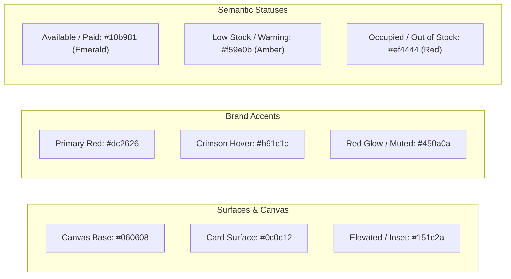

# Design System & UI/UX Standards: VAULT 147 POS

## 1. Visual Identity & Design Philosophy

VAULT 147 POS features a bespoke **Premium Dark Gaming Lounge Aesthetic**. The interface is designed for high-contrast visibility in ambient-lit gaming rooms and billiard parlours.

### Visual Foundations:
1. **OLED Deep Black Canvas**: Minimizes glare and eye fatigue during late-night counter shifts.
2. **Precision Crimson & Neon Accents**: Red and crimson highlights reflect the official Vault 147 gaming brand identity.
3. **High-Legibility Financial Typography**: Monospace and tabular numbers ensure monetary figures align vertically without horizontal jitter.
4. **Instant Touch Feedback**: Generous touch targets (minimum $44 \times 44\text{ px}$) optimized for iPad/tablet and mobile touchscreens.

---

## 2. Color Palette & Design Tokens

### Color Token Reference Table:
| Token Name | Hex Value | Semantic Role & Application |
| :--- | :--- | :--- |
| `surface-canvas` | `#060608` | Primary viewport background across all pages. |
| `surface-card` | `#0c0c12` | Station cards, modal dialogs, and KPI metrics containers. |
| `surface-elevated` | `#151c2a` | Table headers, dropdown selects, and input text fields. |
| `border-subtle` | `rgba(255, 255, 255, 0.08)` | Delicate dividing borders between table rows and sections. |
| `brand-red` | `#dc2626` | Active navigation tabs, primary action buttons, brand logo. |
| `status-emerald` | `#10b981` | Station "Available" badge, GPay payment indicator, balanced cash drawer. |
| `status-amber` | `#f59e0b` | Concessions "Low Stock" badge, drawer surplus indicator. |
| `status-rose` | `#ef4444` | Station "Occupied" badge, "Out of Stock" alert, drawer shortage. |

---

## 3. Typography Hierarchy

Defined in [`tailwind.config.js`](file:///c:/Users/arsha/Downloads/Vault%20Digital/tailwind.config.js):

### Font Families:
1. **Header & Brand**: `fontFamily.microgramma`:
   `['"Microgramma Bold Extended"', '"Microgramma Bold"', 'Microgramma', '"Eurostile Extended"', 'Eurostile', 'Michroma', 'sans-serif']`
   Used for navigation titles, station numbers, and prominent modal headers.
2. **Interface Body**: `fontFamily.sans`:
   `['Inter', 'ui-sans-serif', 'system-ui', 'sans-serif']`
   Clean, modern legibility for labels, descriptions, and customer names.
3. **Financial & Numerical Data**: `fontFamily.mono`:
   `['Inter', 'SFMono-Regular', 'Menlo', 'Consolas', 'sans-serif']` with `tabular-nums`.
   Used for all rupee amounts (₹), countdown timers, stock counts, and timestamps to ensure fixed-width alignment.

---

## 4. Layout Conventions & Responsive Breakpoints

### Mobile Optimization (Smartphones & Handhelds)
- **Vertical Metric Stacking**: On small screens (`< 640px`), financial KPI cards (Total Sales, GPay, Cash, Outstanding) stack **vertically** in a single column rather than cramping into 4 horizontal boxes.
- **Off-Canvas Navigation Drawer**: The sidebar collapses into a slide-over mobile drawer toggled via the hamburger button in `Navbar.tsx`.
- **Bottom Navigation Clearance**: Content viewports include `pb-24` padding so bottom controls are not obscured by mobile browser navigation bars.

### Tablet & Desktop (POS Counters)
- **Grid Layout**: Stations display in an adaptive 2 to 4-column responsive grid (`grid-cols-1 sm:grid-cols-2 lg:grid-cols-3 xl:grid-cols-4 gap-4`).
- **Split Views**: Checkout and Concessions interfaces display side-by-side product selector and order summary panes.

---

## 5. UI Primitives & Interaction Guidelines

- **Quick Stock Adjust Buttons**: Small `$24 \times 24\text{ px}$` (`w-6 h-6`) buttons styled with `bg-zinc-900 hover:bg-zinc-800` allow 1-click inventory management.
- **Cloud Sync Status Badge**: Displays in the header of the Snacks and Transactions pages with an animated spinning icon during active synchronization and an emerald cloud icon when idle.
- **Thermal Receipt View**: Monochromatic high-contrast styling ready for standard 80mm ESC/POS thermal receipt printers.

