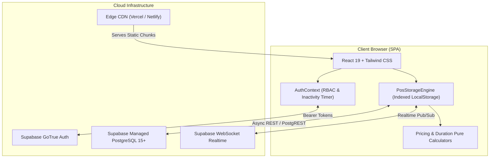

# Project Overview: VAULT 147 POS

## 1. Executive Summary

**VAULT 147 POS** is an enterprise-grade commercial Point-of-Sale (POS), session time-tracking, retail concessions, and financial reconciliation platform purpose-built for high-turnover gaming lounges and tournament billiard centers. 

The system powers **Vault Gaming Centre & Snooker Lounge**, an entertainment venue operating multiple Sony PlayStation 5 console stations and professional English Snooker / 8-Ball Pool tables. It manages continuous station time-tracking, multi-player controller scaling, retail snack sales, split digital and cash payments, daily cash drawer balancing, operational expense recording, and staff role permissions.

---

## 2. Business Problem & Domain Challenges

Operating a modern entertainment lounge presents distinct operational and financial complexities that traditional retail POS systems fail to address:

1. **Revenue Leakage via Unbilled Overtime**: Manual time-keeping on wall clocks frequently leads to customers receiving free unbilled minutes or disputes regarding exact start and end times.
2. **Variable Multi-Player Pricing**: Modern console gaming charges differ based on the number of controllers/joysticks in use (1 player vs 2, 3, or 4 co-op players). Manual calculations often result in under-charging.
3. **Dual Concession Channels**: Snacks and cold beverages are sold both during active gaming sessions (added to the customer's running tab) and directly over the counter to walk-in patrons.
4. **Hybrid Payment Splitting**: Indian retail consumers routinely split bills between digital Unified Payments Interface (UPI / Google Pay) and physical Indian Rupee cash notes. Manual math creates discrepancies during shift handovers.
5. **Cash Drawer Balancing & Theft Prevention**: Counter cashiers must balance physical notes (₹500, ₹200, ₹100, ₹50, ₹20, ₹10, coins) against expected revenue. Without denomination breakdown auditing, drawer shortages go unnoticed.
6. **Network Reliability & Zero-Downtime Requirements**: Lounges operate in environments where internet connectivity can be intermittent. A POS that locks up during a network drop disrupts checkouts and loses active timer states.

---

## 3. Target User Personas

| Persona | Role | Key Responsibilities & Workflows | Access Level |
| :--- | :--- | :--- | :--- |
| **Business Owner / Administrator** | `admin` (e.g. Ruwaidh) | Controls pricing rules, configures hourly/fixed rates, manages employee credentials, audits system logs, reviews unmasked customer contact records, approves expenses, and executes daily drawer closing reconciliations. | Unrestricted Superuser Access |
| **Counter Cashier / Shift Staff** | `employee` (e.g. Rahul, Amit) | Checks in new players, starts session timers, serves snacks/drinks to active stations, rings up walk-in sales, settles final bills, and accepts split payments. Cannot modify catalog pricing or view audit logs. | Operator Access (Restricted) |

---

## 4. Comprehensive Feature Inventory

### A. Gaming Station Management & Time Tracking
- **6 Physical Stations**: 3 Sony PlayStation 5 stations (`ps5-1`, `ps5-2`, `ps5-3`) and 3 Snooker/Pool tables (`pool-1`, `pool-2`, `pool-3`), plus 1 dedicated Walk-in Concessions Counter (`station-walk-in`).
- **Real-Time Duration Calculation**: Elapsed session time is calculated via true UTC millisecond deltas (`end - start`), preventing drift or reset upon browser refresh. Handles midnight rollovers seamlessly.
- **Controller-Tiered PS5 Rates**:
  - 1 Controller / Solo: ₹150 / hour (`15000 paise`)
  - 2 Controllers / Dual: ₹300 / hour (`30000 paise`)
  - 3 Controllers / Trio: ₹400 / hour (`40000 paise`)
  - 4 Controllers / Squad: ₹500 / hour (`50000 paise`)
- **Snooker / Pool Billing**:
  - Hourly Billing: ₹250 / hour (`25000 paise`) with configurable grace period (default 5 minutes).
  - Per-Frame Billing: ₹50 / frame (`5000 paise`) with frame counter controls.
- **Fixed Duration Packages**: 1-Hour Fixed Pass (₹140), 2-Hour Fixed Pass (₹260), 3-Hour Fixed Pass (₹360).
- **Grace Period Protection**: 5-minute initial grace period allows customers to adjust seating without triggering hourly charges.
- **Duration Adjustment**: Quick `-1 min` and `+1 min` buttons allow fine-tuning of billed minutes during checkout.

### B. Concessions & Snack Inventory Management
- **Dedicated Client Inventory Catalogue**:
  - Cold Beverages (₹20): Miranda, Pepsi, Seven Up, Mountain Dew.
  - Chilled Milkshakes (₹30): Vanilla, Badam, Butterscotch, Chocolate.
  - Billiard Accessories (₹100): Snooker Gloves.
  - Hydration (₹10): Mineral Water Bottles.
- **Independent Stock Tracking**: Every product maintains its own stock counter and low-stock alert threshold.
- **One-Click Quick Stock Buttons**: Admins can increment (`+`) or decrement (`-`) stock directly from the grid cards.
- **Automatic Inventory Decrement & Restoration**: Adding snacks to a session or walk-in sale decrements stock immediately; voiding a transaction restores inventory automatically.
- **Walk-in Concessions POS**: Fast-entry counter mode for customers buying refreshments without occupying a station.

### C. Financial Settlement & Split Billing
- **Payment Modes**: Google Pay / UPI (`gpay`), Physical Cash (`cash`), and Split Payment (`split`).
- **Cash Overpayment & Change Due**: Automatically computes exact physical change due when cash tendered exceeds the bill.
- **Digital UPI Overpayment Guard**: Rejects digital UPI overpayments that attempt to dispense physical cash.
- **Payment Method Editing**: Administrators can switch or re-allocate payment methods (e.g. GPay to Cash) after completion with complete audit trails.
- **Discount Safeguards**: Employees are restricted to a maximum discount of ₹50 (`maxEmployeeDiscountPaise = 5000`), requiring admin credentials for larger concessions.

### D. Cash Drawer Closing & Daily Financial Reconciliation
- **Physical Denomination Auditing**: Cashiers enter exact physical note counts for ₹500, ₹200, ₹100, ₹50, ₹20, ₹10, and coins.
- **Zero-Discrepancy Variance Calculation**: Calculates `cashVariancePaise = Counted - Expected`.
- **Financial Invariant Verification**: `Total Sales = GPay Collections + Cash Collections + Outstanding Balances`.

### E. Operational Expense Tracking
- **Daily Expense Logging**: Records venue costs across 8 categories (Supplies, Restock, Maintenance, Utilities, Salaries, Rent, Marketing, Miscellaneous).
- **Payment Tracking**: Flags whether expenses were paid out of cash drawer, GPay, or bank transfer, updating net profit metrics accordingly.

### F. Security, Audit Trail & Privacy
- **Zero Plaintext Credentials**: All passwords hashed using browser Web Crypto API (`PBKDF2`/`SHA-256`) with unique salts.
- **Progressive Rate Limiting**: 5 failed login attempts trigger a 60-second lockout persisting across browser restarts.
- **Customer Phone Number Masking**: Formatted as `***-***-1234` for employee roles; unmasked for administrators.
- **Tamper-Proof Audit Trail**: All system actions logged with actor ID, timestamp, previous state, and new state.

---

## 5. Technology Stack Summary

---

## 6. Hosting, Infrastructure & Status

- **Build Output**: Static SPA bundle generated by Vite in `/dist`.
- **Hosting Targets**: Optimized for Vercel, Netlify, or Cloudflare Pages with single-page client rewrites (`/* -> /index.html`).
- **Database Engine**: Hosted PostgreSQL on Supabase Cloud.
- **Current Quality Status**: Production-grade stability. 109 automated tests passing across 7 test suites with zero failures.

